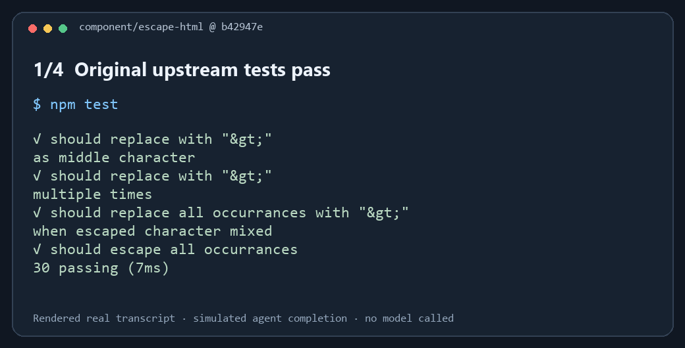

# Amabie

**A verification gate for coding agents.** The agent implements a change;
Amabie runs the project's checks and compares their result with the starting code.
A claim of “done” is never proof.

```sh
npm install --global amabie-cli
amabie setup --yes
```

Run setup once, from your own terminal, inside a Git repository with declared
checks and Claude Code or Codex CLI. Requires Node.js 22+, npm and Git.

**Version:** this source is 2.0.1, including the session guards and CLI registration
fallback described below. These fixes are absent from 2.0.0. Check the published
version with `npm view amabie-cli version`. To test this checkout,
run `npm ci`, `npm run build:force`, `node tooling/pack.mjs`, then install
`./pack/npm/amabie-cli-2.0.1.tgz`.



[Reproduce this case](https://github.com/criptofn/Amabie/blob/main/examples/real-repo/README.md):
original upstream tests, a green replacement command, a blocked completion, and
restoration. This is a simulated agent completion; no model or reliability rate is measured.

## Start with a failing test

1. Write a test for the required behaviour and confirm it fails. Commit that
   reviewed test and run `amabie setup --yes` before starting the agent task.
2. Ask the agent to implement the behaviour without changing the existing test.
3. At completion, Amabie runs the sealed checks. A check that fails without the
   implementation and passes with it provides evidence about the change.

The [workflow guide](https://github.com/criptofn/Amabie/blob/main/docs/WORKFLOW.md)
also explains new agent-written tests, existing-test edits and refactoring.

| Result | What it means |
|---|---|
| `READY` | The checks and applicable proof obligations passed. Read any evidence-origin caveat. |
| `NOT PROVEN` | The available evidence does not establish the change or a requirement. This is not a finding that the code is wrong. |
| `NEEDS ATTENTION` | A check failed or verification could not run safely. The output points to the cause and full log. |

## Claude Code registration

Approve the project server once in Claude's `/mcp` menu. The agent registers
each request with `amabie_task`. If approval is pending, the request hook gives
it a CLI alternative:

```sh
amabie task "implement the requested behaviour" --requirement "exact criterion" --session <id-from-hook>
```

Registration records the request; it does not approve or prove it. The agent
cannot use `setup`, `bind`, `accept`, `uninstall`, or direct protected-file edits
to approve its own work through the Claude hook. Administrative changes during
an open session require review and confirmation in a human terminal.

## Scope and evidence

Claude Code hooks can block completion. Codex hooks require the user's trust;
other integrations can be advisory. The current capability is **LOCAL**: worker
and verifier share an OS user. These guards are not an OS sandbox against a
determined same-user process.

No token-saving or comparative superiority claim is established. Historical
benchmarks and their withdrawn claims are kept in the
[dated reference](https://github.com/criptofn/Amabie/blob/main/docs/history/README-2.0.md).

- [Runnable quickstart](https://github.com/criptofn/Amabie/blob/main/QUICKSTART.md)
- [Compatibility](https://github.com/criptofn/Amabie/blob/main/docs/COMPATIBILITY.md)
- [Security contract](https://github.com/criptofn/Amabie/blob/main/SECURITY.md)
- [Contributing and module map](https://github.com/criptofn/Amabie/blob/main/CONTRIBUTING.md)

Apache-2.0. Historical `canary` command names are compatibility aliases.
